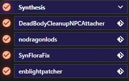

# Adding mods to AVO

**NO SUPPORT IS PROVIDED FOR ANY MODIFICATIONS THAT YOU UNDERTAKE. BY UNDERTAKING ANY MODIFICATIONS YOU VOID ALL SUPPORT BOTH ON GITHUB AND IN THE AETHERIUS MODDING SERVER.**

## Disclaimer

No modifications are supported as we cannot track down what everyone has done. If you have modified your list, you void your support and bug reporting.

## Things to Know Before Modifying

AVO uses **Skyrim version 1.5.97**. This means that **you need to use plugins that are made for Skyrim version 1.5.97**. If your desired plugin does not exist for 1.5.97 then you cannot use it.

AVO is `method` patched which means that you can, within reason, remove or change near enough anything. Modgroups are included so ensure that you **disable them** when you are adding anything.

The only things that are not method patched are the generated outputs. These **will need to be regenerated** depending on what you change. More details are given in the relavant sections.

## Before You Begin

You may have seen us say "the left should match the right" when it comes to modlists, but what does this actually mean?

What it essentially means is that your mod order on the left hand side of MO2 matches the plugin order on the right. For example, USMP is designed to load after USSEP and on the right hand plugin view side will load like that. Therefore, we should place the USMP mod on the left hand below USSEP in priority. Whatever loads lower in priority (higher number) will be what is loaded in the game.

### Bash & Smash

**NEVER** attempt to create a Bash or Smashed patch on AVO. You should **ONLY** use Wrye Bash to swap masters on a plugin or use the mod-checker and **NEVER** attempt to use Smash on this list. Bash and smash patches are, for Skyrim Special/Anniversary Edition, broken and **SHOULD NOT** be used. You can do almost everything they do via a custom patch in xEdit.

Neither tool is included with the list as they are not required. If you do wish to add Bash, **you will need to reroute the managed game to your vanilla install**. If you do not, you will break the load order.

### Loot

No.

Do not use Loot. Use xEdit, follow the "left matching right" philosophy and also use common sense.

### Synthesis

If you add any mod with a plugin, it's recommended to re-run Synthesis. The patchers are split into 2 groups and can be seen below:

No custom data is used in these patches so you can just simply run them.

## Regenerating AVONG's Lods

The order to do LOD regeneration is: xLodGEN, Grass Cache, ACMOS Road Gen, TexGen, DynDOLOD.

Open up [this guide](https://github.com/The-Animonculory/Modding-Resources/blob/main/DynDOLOD.md) and follow the steps listed. AVO's preset for DynDOLOD is saved so that you can load that instead of doing the pre-configuration.

## Adding Mods

Move every addition you make **above** the Synthesis and DynDOLOD esps. There is 191 free `ESP/ESM` slots in AVO for you to use. Don't consider that a competition though as less is more and ESPFE (ESP flagged ESL) are often a better choice. 

**WARNING**: All newly added plugins must not have deleted references or be cleaned of them. Failure to do so will result in DynDOLOD being unable to generate Large reference workaround.

### DLL Plugins

For mods that include SKSE Plugins, **you need to use plugins that are made for Skyrim version 1.5.97**. This is mandatory and if your desired plugin does not exist for 1.5.97, then you can't use it.

Should you wish to use a plugin that is for a newer version of Skyrim, you will need to upgrade the stock game folder and replace **ALL** dll mods which are not utilising the CommonLib-NG.

***

### Armors and Weapons

Anything that replaces vanilla armors and weapons should be placed **after** Dynamic Lowered Hoods. **NOTE**: The Bodyslide output is mapped to use Resurgence textures except for a few certain mods. Should you wish your new armor mod to be used in Bodyslide, place it after `Sleek Wolf Armor` on the left pane and then rebuild Bodyslide. There are numerous tutorial on how to do this online so we will not cover this here.

Any new weapons that are added should have a `Better Shaped Weapons` patch merged in with them to provide consistency.

***

### General Mesh/Texture Replacers (Excluding NPC's)

:warning: :exclamation: **READ THIS SECTION EXTREMELY CAREFULLY! FAILURE TO DO SO WILL RESULT IN FUNDAMENTAL ERRORS!** :warning: :exclamation:

AVO utilises Parallax **extensively**, and as such any mesh replacers need to be compatible with the setup that is there. Lux and Lux Orbis are also utilised which replace a **lot** of meshes to improve lighting. Take **EXTREME CARE** when resolving mesh conflicts.

Beginning with V8, AVO is now utilising Majestic Landscapes Complex Parallax and Majestic Mountains Complex Parallax. As a result of these changes, **ANY** landscape texture replacers **MUST BE EXPLICITY COMPATIBLE** with these mods. Failure to utilise one which is will result in **landscape seams** and potential **parallax errors**.

AVO also utilises **Grass Lods** generated via a combination of DynDOLOD and No Grass In Objects. Both tools are present in the list and **require re-running** each time to you alter anything in the tamriel worldspace. Please refer to our [Grass Lods Guide](https://github.com/The-Animonculory/Modding-Resources/blob/main/Grass%20Lods.md) for more information and steps to re-generate.

:warning: You will have no grass if you do not properly follow this guide! :warning: 

***

### Interiors

JK's Interiors and other interior mods may be added to AVO reasonably safely. Just make sure to resolve any conflcits that arise and also re-install Lux to ensure lighting is correct.

***

### NPC Replacers

These are mods that change things relating to:
- NPC's
- Facedata

By default, AVO does not come with any NPC overhauls. If you wish to add any, simply add them in using the methods mentioned above and resolve any conflicts that arise.

If you wish to create new facegen via the CK, please follow [this guide](https://github.com/The-Animonculory/Modding-Resources/blob/main/Regenerating%20Faces%20in%20the%20Creation%20Kit.md) which details the process of doing so.
