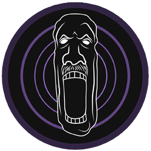
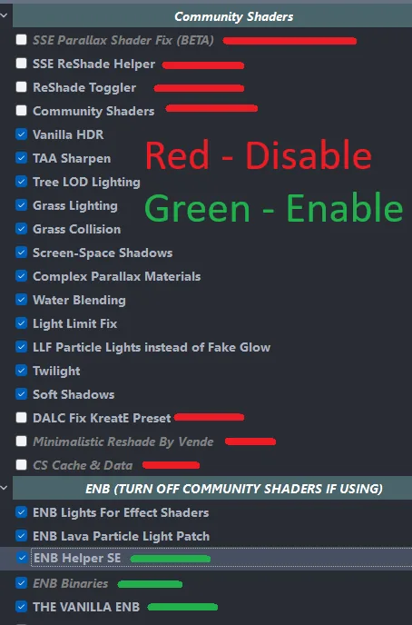

# :evergreen_tree: Althro's Visual Overhaul - Next Generation (AVO)

Wabbajack Modlist Installer by Althro with support from Aetherius Modding.

<table stlyle="border: none;">
<tr>
<td></td>
<td><a href="https://github.com/wabbajack-tools/wabbajack/releases">Download on Wabbajack</a></td>	
<td><a href="https://loadorderlibrary.com/lists/animonculory-visual-overhaul">View modlist</a></td>
<td></td>
<td></td>
</tr>
</table>

[![CC BY-NC-SA 4.0][cc-by-nc-sa-shield]][cc-by-nc-sa]

[![CC BY-NC-SA 4.0][cc-by-nc-sa-image]][cc-by-nc-sa]

[cc-by-nc-sa]: http://creativecommons.org/licenses/by-nc-sa/4.0/
[cc-by-nc-sa-image]: https://licensebuttons.net/l/by-nc-sa/4.0/88x31.png
[cc-by-nc-sa-shield]: https://img.shields.io/badge/License-CC%20BY--NC--SA%204.0-lightgrey.svg

## :information_source: Preamble

> `"...the best way to make your own list."`
> 
> `"...gorgeous visuals and ability to make it your own..."`
>
> `"...absolutely amazing..."`

**Althro's Visual Overhaul** (AVO) is designed as a "true to vanilla list" to build your own list upon. It has been installed over 12 thousand times and garnered a reputation for being incredibly stable and is, as the quote says, "the best way to make your own list."

AVO seeks to bring the game up to modern standards utilising some of the best techniques and technologies availiable, whilst still remaining within reach of most modders. Expect to find minimal tweaks to settlements, essential bug fixes and tweaks, and an extremely well rounded and comprehensive graphical overhaul package.

Curious about how it looks? Watch this video from [Biggie Boss](https://www.youtube.com/@biggie_boss) on it.

This work is licensed under a [Creative Commons Attribution-NonCommercial-ShareAlike 4.0 International License][cc-by-nc-sa].

## :computer: System Requirements

### Disclaimer

Owing to the need to clean master files and certain errors with Wabbajack, AVO only supports **English Steam** versions of Skyrim SE. **GOG and other Languages are not supported**.

Only, Windows 10 and 11 work with Wabbajack fully. LTSC, special variants, lightened editions or any other modified variant **WILL NOT WORK**. Linux compatability is **not possible** at this time owing to certain libraries not present in Wine/Proton required for MO2.

Running the list from Hard Disk Drives or external drives is **STRONGLY ADVISED AGAINST**. A lot of content is swapped at game run time and, as a result, fast storage and ram is needed.

***

### Recommended System Requirements

AVO requires a mid to high tier modern system to run to it's fullest potential. The recommended specs given below are based on utilising the ENB in the list. For community shaders, you can subtract a little bit off them.

Recommended 1080p/60fps:

| Component    | Recommended | Example |
|:--------------:|:-------------:|:---------:|
| CPU | 6 core/12 thread | i7 9700k/AMD R5 3600x |
| Ram | DDR4 Ram  + 20GB Pagefile | 16GB CL16 |
| Storage | SSD | 1TB Sata based |
| GPU | 8GB VRAM | RTX 3060 **or** AMD RX6700xt |

Recommended 1440p/60fps:

| Component    | Recommended | Example |
|:--------------:|:-------------:|:---------:|
| CPU | 8 core/16 thread | i7 11700k/AMD R5 5800x |
| Ram | DDR4 Ram  + 20GB Pagefile | 32GB CL16 |
| Storage | NVME SSD | 1TB M.2 NVME |
| GPU | 10GB VRAM | RTX 3080 **or** AMD RX6800 |

My specs (1440p 21x9 ENB @ locked 61fps):

| Component    | Item |
|:--------------:|:-------------:|
| CPU | R7 5800x |
| Ram | 32GB DDR4 Ram  + 20GB Pagefile |
| Storage | 2TB M.2 NVME |
| GPU | RTX 3090 FE | 

Space required: Approx 136GB (Downloads included) + 30GB working room for Wabbajack.

:warning: **NOTE**: AMD RX 580 and older cards are **not supported**. :warning:

## :page_facing_up: Installation

Installing AVO is relatively easy and, if you have Nexus Premium, will be a simple waiting game. If you are updating the modlist, you can safely skip to the [updating section](#updating).

### :clipboard: Pre-Installation

Prior to installing AVO, please complete the following steps.

1. Install [Visual C++ x64](https://aka.ms/vs/16/release/vc_redist.x64.exe) & [.Net Runtime v5 desktop x64](https://dotnet.microsoft.com/download/dotnet/5.0/runtime).
2. Change Skyrim so it does not [automatically update](https://help.steampowered.com/en/faqs/view/71AB-698D-57EB-178C#disable).
3. Fully uninstall Skyrim by deleting the folder and the Skyrim Special edition folder inside \Documents\My Games\.
4. Fully disable OneDrive and any other programs which hook into user file areas.
5. Reinstall Skyrim into a location that is not Program files. Somewhere like `C:\Games` is a good location. If you only have one drive, look into LostDragonist's [SteamLibrary tool](https://github.com/LostDragonist/steam-library-setup-tool/wiki/Usage-Guide).
6. Start the game once and let it do the graphics check. Do not worry about the settings as it will be replaced during installation.
7. Remove/Disable any 3rd party antivirus such as MalwareBytes or Webroot. These **will** mess with the installation and, in the case of the latter, causes more problems than it solves.

***

### :page_with_curl: Wabbajack Installation

#### :scroll: Installing Wabbajack

Once you have completed pre-installation, download the [latest version of Wabbajack]((https://github.com/wabbajack-tools/wabbajack/releases)) and place it in a folder such as `C:\Games\Wabbajack`. Do not place it in program files, on your desktop or in your downloads folder. I recommend placing it on an SSD as it will work quicker on there.

:warning: **NOTE**: AVO will **always** require the latest version of Wabbajack **UNLESS IT IS SPECIFICALLY STATED HERE**. :warning:

#### :open_file_folder: Downloading and Installing AVO

Downloading and installing AVO can take a while depending on your internet connection and computer. To install AVO, complete the following steps.

1. Open Wabbajack and click on browse modlists.
2. Press the download button on AVO and wait for it to download.
3. Set the installation folder to be somewhere like C:\Games\AVO. **Do not install it to your desktop or downloads folder.**
4. The download location does not need to be on a SSD but it makes installing a bit faster.
5. Press the play button to begin.
6. Go and pet your nearest fluffy animal whilst Wabbajack does its thing. Alternatively read through this readme again.
7. If the installation is successful, jump for joy and move onto [post installation](#post-installation). If the installation is unsuccessful, follow what is below.

***

##### :confused: Problems with installation

It is possible that you may encounter an error with Wabbajack when installing. Some common issues are listed below.

- Could not download x:
	- Big files can fail to download due to connection issues. You can either run wabbajack again or download the file manually. If you decide to manually download it, make sure to place it in the same place as the other downloads.

- x is not a whitelisted download:

	 - This will happen when I update the modlist. Please check if there is a new update or wait until you see a release ping.

- Wabbajack could not find my game folder:

	- Either buy the game or go back to the [Pre-Installation](#pre-installation) step.

- Antivirus reports a virus:
	- You did not follow the steps in [Pre-Installation](#pre-installation). Go back and follow it.
	- If you have followed it then you can fix this by [adding an exclusion for Mod Organizer in windows defender](https://www.thewindowsclub.com/exclude-a-folder-from-windows-security-scan).

## :floppy_disk: Post-Installation

### :file_folder: Stock Game & Root Builder

AVO utilises a Wabbajack technology called Stock Game. What this essentially does is create a copy of your Skyrim installation within the installation location of the list. This enables greater compatability with other mod-lists.

As of version 7, AVO now utilise Root Builder alongside Stock Game to enable easier management of hooks such as Reshade and Engine Fixes. Please see our guide to [Root Builder](https://github.com/The-Animonculory/Modding-Resources/blob/main/Root%20Builder%20for%20Skyrim%20AE.md) for more details.
***

### :telescope: Post Processing

AVO uses [Azurite Weathers II](https://www.nexusmods.com/skyrimspecialedition/mods/12125) for its weather mod and [Lux](https://www.nexusmods.com/skyrimspecialedition/mods/43158) for lighting. By default, the list comes pre-setup with [Community Shaders (CS)](https://www.nexusmods.com/skyrimspecialedition/mods/86492) and all addons required.

[The Vanilla ENB](https://www.nexusmods.com/skyrimspecialedition/mods/69595) is included as ENB options. If you wish to enable them, you need to deactivate certain mods. The picture below shows which mods to de-activate and to enable:

**NOTE**: Screenshots save to `Overwrite\Game Root`.

**NOTE**: By default, the list is **capped at 82fps**. To change this, you will need to adjust the `ini` file in `SSE Display Tweaks` and disable the framerate lock in ENB if using.

## :arrow_forward: Playing the List

### :arrow_upper_right: Ultrawide Setup

To enable 21x9 ultrawide support, activate the mods under `21x9 user interface`. **NOTE**: Resolutions outside of 21x9 and 16x9 are **NOT** supported.

### :mag: Realtime performance monitoring

AVO includes a mod which enables you to see your FPS and VRAM usage in realtime. To enable this, activate the mod called `OSD Font for SSE Display Tweaks`. **NOTE**: This comes enabled by default.

***

### :runner:  Starting up the list
Open the installation folder and double click on the program called `ModOrganizer.exe`. 

Make sure the dropdown box on the right is set to `SKSE` and press the `Run` button.

### :bookmark: In-Game MCM options

AVO has no required MCM options to be selected, however you can load the smoothcam preset if you wish to do so.

- SmoothCam
	- Load Preset

You are welcome to change any others to achieve your desired setup.

### :horse_racing: Starting the Game

By default, AVO uses [Optional Quick Start](https://www.nexusmods.com/skyrimspecialedition/mods/63953) to bypass the starting sequence of the game and spawn you into the Helgen tunnel. The equipment chest has been custom configured for the list to provide a range of starting equipment.
	
## :chart_with_upwards_trend: Updating the modlist

Before updating, please check the changelog and back up your saves. You may need to start a new game after certain updates.

Updating is like installing the list. Simply make sure your paths are the same and tick the `overwrite existing modlist` button. **Note**: Any mods you have added will be deleted when updating.

### :nut_and_bolt: Tweaking the Game Settings

#### :signal_strength: BethINI

To get some more FPS, tweak the following value in the detail section in BethINI.

- `Shadow Resolution`: 2048
- `Remove Shadows`: I really don’t recommend turning this on, but if you must, then you can.

## :put_litter_in_its_place: Removing the Modlist
Simply delete the folder, and you have uninstalled it.

## :nut_and_bolt: Modifying AVO

Please see [Adding mods to AVO](https://github.com/Althro/AVO/blob/main/Adding%20mods%20to%20AVO.md) for a brief rundown on how to add mods. **NOTE: NO SUPPORT IS PROVIDED FOR MODIFIED INSTALLS.**

## :hearts: Credits and Thanks

- _YOU_ for reading this.
- The Aetherius Modding Team.
- The beta testers on Aetherius Modding.
- Noggog for Mutagen.
- xSlim for Proofreeading documentation.
- Umgak for help patching.
- Halgari and everyone the WJ Team - Wabbajack is awesome and so are you.

## :telephone_receiver: Contact

Whilst I am available primarily on [my server](https://discord.gg/xRrHRsb5e9), please check the [issues](https://github.com/Althro/AVO/issues) tab on github first if you have any issues. DO NOT DM ME ON DISCORD.

You are welcome to [contribute](https://github.com/Althro/AVO/blob/main/Contributing.md) to the list, however please check the [changelog](https://github.com/Althro/AVO/blob/main/Changelog.md) before you do.
